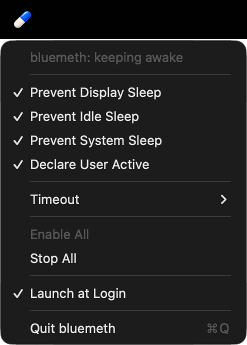

# Bluemeth

A keep-awake menu bar app for macOS that does what `caffeinate` does, without
`caffeinate`. Written in Rust, one process, no polling, nothing spawned.



* **Prevent Display Sleep**, **Prevent Idle Sleep**, **Prevent System Sleep**
  and **Declare User Active**, each toggled independently. These are the four
  things `caffeinate -d -i -s -u` do.
* **Timeout**: never, a preset (5 min to 4 h) or a custom duration such as
  `1h30m`. The remaining time counts down in the menu bar.
* **Enable All / Stop All**, **Launch at Login**, and that is the whole UI.
* Settings persist across launches; relaunching at login resumes keeping the
  Mac awake.

Also in the box:

* `bluemeth`, a `caffeinate`-compatible command line tool
  (`bluemeth -dis -t 1h`, `bluemeth -i make`, `bluemeth -w <pid>`,
  `bluemeth status`).
* `bluemeth-core`, the library both are built on, with a stub backend for
  other platforms (see [docs/PLATFORMS.md](docs/PLATFORMS.md)).
* `bluemeth-bench`, which measures all of the above against `caffeinate`
  using the kernel's own per-process accounting.

## How it works, and why it is lighter than `caffeinate`

`/usr/bin/caffeinate` is a thin wrapper over IOKit power assertions:
`IOPMAssertionCreateWithProperties` per flag, `IOPMAssertionDeclareUserActivity`
for `-u`, a `TimeoutSeconds` property for `-t`. Bluemeth calls the same four
IOKit functions directly from the process that wants to stay awake. A menu bar
app that shells out to `caffeinate` instead pays for a second process on every
toggle: `fork`/`exec`, dyld, a second heap, and a kill-and-wait to release.

Measured on this machine (Apple silicon, macOS 27), full tables in
[docs/BENCHMARKS.md](docs/BENCHMARKS.md):

| | in-process IOKit (Bluemeth) | spawn `caffeinate` |
| --- | ---: | ---: |
| Take 3 assertions | ~120 µs | ~7 ms |
| Release them | ~70 µs | ~1.2 ms |
| CPU used by the holding process over 10 s | 0.10 ms | 0.36 ms |
| Memory footprint of the holding process | 2.4 MB | 2.4 MB |
| Extra processes | 0 | 1 |

The app itself, holding all three assertions with no countdown shown, uses
about 2 ms of CPU per 30 s, zero idle wake-ups and 13 MB of memory, of which
12 MB is AppKit's floor for any status-item app (measured with a do-nothing
Objective-C app in `scripts/leak-baseline.m`). Showing the 1 Hz countdown
costs the same as it costs any AppKit app to redraw a status item once a
second, about 0.6 % of one core, and stops when the countdown does.

See [docs/ARCHITECTURE.md](docs/ARCHITECTURE.md) for the design.

## Memory safety and leaks

The app is meant to run for weeks, so this is treated as a correctness
requirement, not a nice-to-have:

* Every assertion is an RAII handle; dropping anything releases it. The OS
  also drops all of a process's assertions when it exits, however it exits.
* `unsafe` exists only at the FFI edges, every block has a `SAFETY:` comment,
  and `clippy::undocumented_unsafe_blocks` is a hard error.
* `cargo test` includes end-to-end checks against `powerd`'s live assertion
  table and a test that runs thousands of create/release cycles and fails on
  any per-cycle growth of the process footprint.
* `scripts/leakcheck.sh` runs Apple's `leaks` on the CLI (must report 0) and
  on the live app next to the Objective-C baseline app (must not exceed it,
  must not grow over time). `bluemeth-bench inproc` reports zero footprint
  growth over 30 000 cycles.

## Build, run, install

Requires Rust 1.85+ and Xcode Command Line Tools.

```sh
make build            # debug build of everything
make test             # unit + integration tests (they talk to the real powerd)
make lint             # rustfmt + clippy with -D warnings
make run              # run the menu bar app unbundled (Launch at Login disabled)
make bundle           # target/Bluemeth.app, ad-hoc signed
make install          # ...and copy it to /Applications
make leaks            # scripts/leakcheck.sh
make bench            # release build + bluemeth-bench all
```

`Launch at Login` uses `SMAppService` and therefore needs the bundled app
(macOS 13+). The bundle is ad-hoc signed; replace `-` in `scripts/bundle.sh`
with a Developer ID to notarise.

### CLI

```
bluemeth [-dimsu] [-t TIMEOUT] [-w PID] [--backend iokit|caffeinate] [utility [args...]]
bluemeth status [PID]
```

Flags match `caffeinate(8)`. Differences: `-t` accepts `90s`, `5m`, `1h30m`
as well as seconds; `-u` with `-t`, `-w` or a utility re-declares user
activity every 30 s for the whole duration instead of once; `status` prints
the system assertion table; `--backend caffeinate` spawns Apple's tool
instead, for A/B comparisons.

## Layout

```
crates/core    bluemeth-core    Config, Inhibitor, IOKit backend, inspector, rusage sampler
crates/cli     bluemeth         CLI (kqueue-based wait loop)
crates/app     bluemeth-app     AppKit menu bar app via objc2, bundled as Bluemeth.app
crates/bench   bluemeth-bench   benchmarks
scripts/       bundle.sh, leakcheck.sh, leak-baseline.m
docs/          ARCHITECTURE.md, BENCHMARKS.md, PLATFORMS.md
```

## License

MIT
